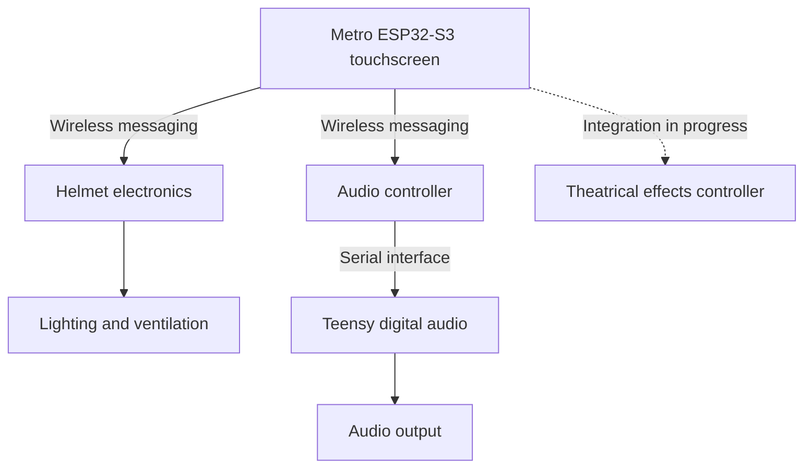

# NCR Ranger Electronics

**Distributed embedded systems for an interactive wearable theatrical prop**

An independent engineering project exploring modular firmware, wireless communication, touchscreen interfaces, digital audio processing, and hardware integration in a wearable costume platform inspired by Fallout.

## Engineering objectives

- Separate subsystem responsibilities into independently developed firmware projects.
- Provide a unified touchscreen control interface.
- Coordinate distributed electronics using wireless messaging.
- Support incremental hardware testing and maintainable firmware development.
- Preserve known-good configurations during iterative prototyping.

## System architecture

The current development architecture uses an ESP32-S3 central touchscreen controller and separate embedded nodes for helmet electronics, audio, and theatrical effects. The audio subsystem delegates digital audio processing to a Teensy 4.1 over a serial interface.

The original UNO R4 and XIAO radio bridge architecture remains part of the project's development history.

## Technology stack

| Area | Technology |
| --- | --- |
| Embedded development | C++, Arduino, PlatformIO |
| Controllers | ESP32, ESP32-S3, Teensy 4.1 |
| Wireless communication | ESP-NOW |
| Local communication | UART |
| User interface | TFT touchscreen |
| Audio | Teensy Audio Library, digital signal processing, SD playback |
| Development | Git, feature branches, hardware verification |

## Development status

This is an active prototype, not a completed production system. The current development architecture is distributed across feature branches; the default branch retains the earlier firmware baseline.

| Capability | Status |
| --- | --- |
| Touchscreen interface | Hardware-tested baseline |
| Helmet communication | Prototype integration |
| Voice modulation | Hardware-tested |
| SD-based audio playback | Hardware-tested |
| Local audio effects playback | Hardware-tested |
| Wireless audio controls | End-to-end verification pending |
| Theatrical effects subsystem | Integration in progress |
| Full system regression and endurance testing | Pending |

Status reflects documented development results rather than independent certification or automated test coverage.

## Engineering workflow

Development is organized around subsystem-specific firmware projects and feature branches. The workflow emphasizes reviewing changes, compiling before flashing, verifying on hardware, documenting results, and preserving stable firmware baselines.

Selected development documentation:

- [Development standards](https://github.com/iramos85/ncr-ranger-electronics/blob/feature/shoulder-cannon-integration/docs/DEVELOPMENT.md)
- [PlatformIO setup](https://github.com/iramos85/ncr-ranger-electronics/blob/feature/shoulder-cannon-integration/docs/PLATFORMIO_SETUP.md)
- [Audio architecture and verification notes](https://github.com/iramos85/ncr-ranger-electronics/blob/feature/shoulder-cannon-integration/docs/RANGER_AUDIO_SYSTEM.md)

## Portfolio scope

This project demonstrates independent systems engineering, technical decision-making, iterative prototyping, and integration across software and physical electronics. It is a personal theatrical costume project, not affiliated with the owners of the Fallout franchise.

The repository is currently private while its source, assets, and commit history are reviewed for appropriate public disclosure.
